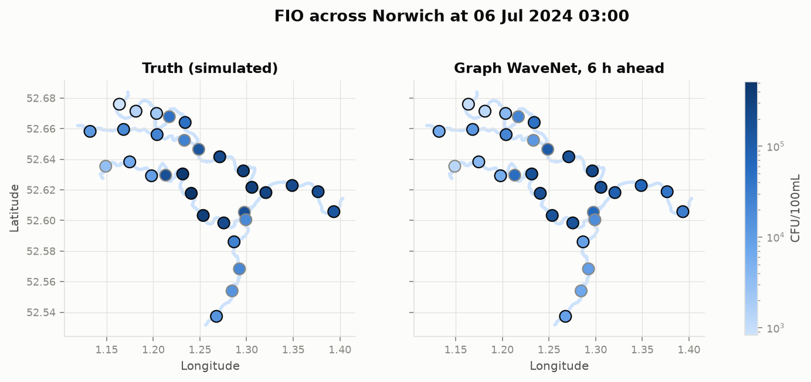
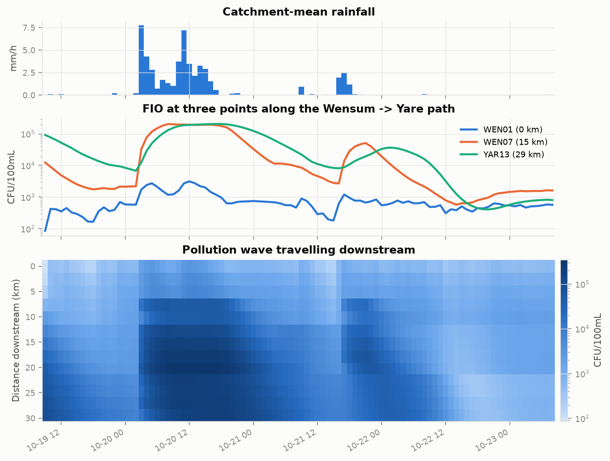

# RiverCast

RiverCast is a small prototype that forecasts river pollution across Norwich a few hours ahead.
It treats the river network as a graph, so a model can learn how pollution travels downstream
from one place to the next.

- **Demo presentation:** _coming soon_ <!-- TODO: add demo video / slides link -->
- **Live map:** _coming soon_ <!-- TODO: add Vercel URL -->



## The idea

Bathing-water forecasts in the UK usually treat each site on its own. But rivers are connected:
a sewer overflow in the city centre reaches sites downstream hours later. RiverCast tests whether
a graph model that knows this structure forecasts better, especially at places with no sensor.

## Research it builds on

| Paper | What I used it for |
|---|---|
| Forecasting Bathing Water Quality in the UK: A Critical Review (2024) | Rain-driven pollution spikes, hourly forecasts, scoring on spikes |
| Predicting Norovirus Contamination and Antimicrobial Resistance in Coastal Waters (2026) | Three targets (FIO, norovirus, AMR) that move with the water |
| Trapping and Bypassing of Suspended Particulate Matter and Faecal Indicator Organisms (2024) | Directed river graph, flow-driven transport, resuspension |
| Comparative Impact of Sunlight and Salinity on Human Pathogenic Virus Survival (2025) | Decay based on T90, faster in sunlight and warm water |
| Graph WaveNet for Deep Spatial-Temporal Graph Modeling (Wu et al., 2019) | The main forecasting model |
| Temporal Fusion Transformers for Multi-horizon Forecasting (Lim et al., 2021) | Forecasting several horizons with quantiles |

## Data

The river network and the weather are real. The pollution is simulated, standing in for the
hydrodynamic model outputs the full project will use.

| Data | Source | Type |
|---|---|---|
| River network: Yare, Wensum, Tud, Tas, cut into 31 reaches of about 2.5 km | OpenStreetMap | Real |
| River flow and rainfall, hourly, 2022 to 2024 | Environment Agency gauges | Real |
| Air temperature and sunlight | Open-Meteo (ERA5) | Real |
| FIO, norovirus and AMR concentrations | RiverCast simulator | Simulated |

**The simulator** moves pollution down the river graph, one reach at a time:

- **Sources:** sewer overflows during heavy rain, treatment works, farm runoff, and sediment
  stirred up when the flow rises.
- **Transport and decay:** faster flow carries pollution further, flows dilute where rivers meet,
  and microbes die off faster in sunlight and warm water.
- **Sensors:** only 70% of reaches are measured. Readings are noisy, norovirus and AMR are daily
  lab samples, and low values fall below a detection limit.



## Models

Every model looks at the last 24 hours and forecasts all three pollutants 1, 3, 6 and 12 hours
ahead, with a 10%, 50% and 90% quantile to show uncertainty.

- **Persistence:** "the next value equals the last one". A simple baseline.
- **XGBoost:** gradient-boosted trees on lagged features for each site.
- **LSTM:** a recurrent network for each site, with no knowledge of the river graph.
- **Graph WaveNet:** time convolutions plus graph convolutions over the river network, with one
  shared model for all three pollutants (multi-task learning).

Models learn from the sparse, noisy sensor readings and are scored against the true simulated
values on unseen data (July to December 2024).

## Experiments and results

| Error (MAE, log10) | Persistence | XGBoost | LSTM | Graph WaveNet |
|---|---|---|---|---|
| All reaches | 0.54 | 0.78 | 0.38 | **0.33** |
| Reaches with a sensor | 0.44 | 0.34 | 0.33 | **0.33** |
| Reaches without a sensor | 0.78 | 1.86 | 0.50 | **0.35** |

- **Graph vs no graph:** where there is no sensor, Graph WaveNet's error is 31% lower than the LSTM's.
- **Multi-task vs single-task:** one shared model performs as well as three separate ones
  (0.332 vs 0.334). Sharing helps norovirus most, the pollutant with the least data.
- **Storms:** errors roughly double in the most polluted 5% of hours, but Graph WaveNet stays best.
- **Alerts:** for bacteria above 1,000 CFU/100 mL six hours ahead, 86% of alerts are correct
  (F1 0.72).
- **Uncertainty:** the 80% bands contain about 86% of true values for FIO and AMR. Norovirus is
  forecast too high, because most samples are below the detection limit.

Full tables are in `results/phase3.md`.

## Run it

```bash
uv sync
uv run python scripts/build_dataset.py   # download real data and simulate pollution
uv run python scripts/train.py           # train all models (about 1 hour on a CPU)
uv run python scripts/evaluate.py        # accuracy tables
uv run python scripts/experiments.py     # experiments and figures
uv run pytest
```

## Limitations and next steps

The pollution data is simulated, so the results show the method works, not that it is accurate
on real rivers. Next steps: real hydrodynamic outputs and sampling data, a loss that handles
values below the detection limit, and rainfall forecasts as inputs. See [PLAN.md](PLAN.md).

Data: OpenStreetMap contributors (ODbL), Environment Agency (Open Government Licence v3.0),
Open-Meteo (CC BY 4.0).
