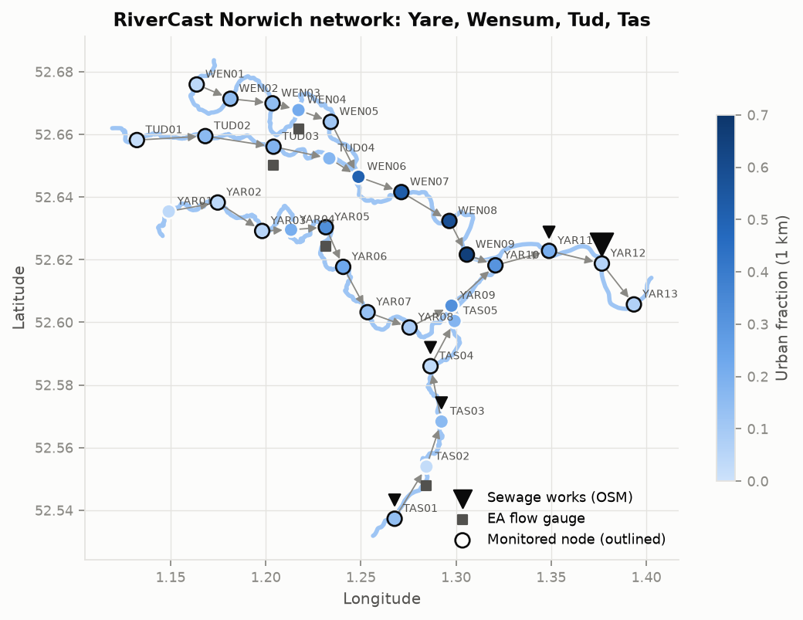
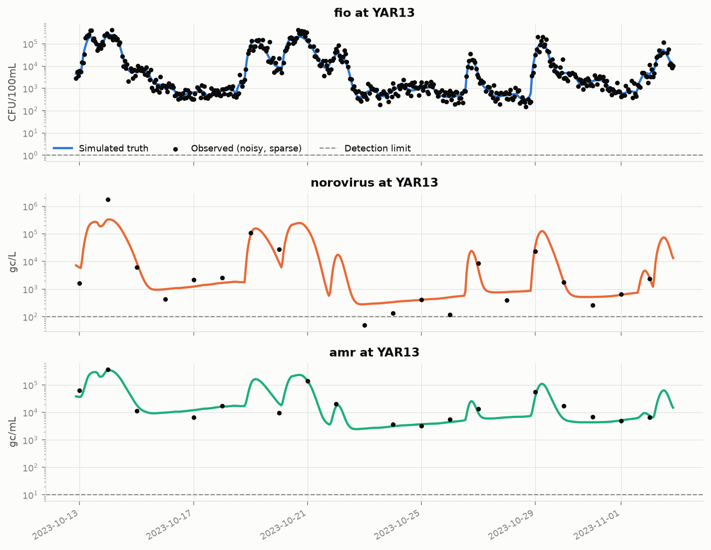

# RiverCast

Physics-aware spatio-temporal graph learning for river pollution forecasting, with uncertainty.

RiverCast asks one question: **does modelling how river locations connect improve short-term,
multi-pathogen pollution forecasts** compared with the non-graph models used in UK
bathing-water forecasting today?

The study area is the Norwich river network (Yare, Wensum, Tud, Tas).



## Data (Phase 1)

| Component | Source | Real or simulated |
|---|---|---|
| River network (31 reaches, ~2.5 km) | OpenStreetMap waterways | Real |
| Sewage treatment works | OpenStreetMap `man_made=wastewater_plant` | Real locations, assumed effluent |
| Urban fraction per node | OpenStreetMap land use | Real |
| River flow (4 gauges) | Environment Agency Hydrology API | Real |
| Rainfall (4 gauges) | Environment Agency Hydrology API | Real |
| Air temperature, solar radiation | Open-Meteo (ERA5) | Real |
| FIO, norovirus, AMR concentrations | RiverCast simulator | **Simulated** |

The simulator treats each node as a well-mixed reach and routes pollution downstream:

- **Sources:** treated effluent, rain-triggered storm overflows in urban reaches, farm runoff,
  bed resuspension on rising flow, and upstream inflow whose concentration rises with flow.
- **Transport:** flow-dependent velocity (`v = a·Q^b`), and flows add at confluences.
- **Decay:** first-order, temperature-corrected, plus sunlight inactivation (T90-based,
  cf. Kevill et al. 2025).
- **Targets:** faecal indicators (hourly sensors), norovirus and AMR (daily grab samples).
  Norovirus has a winter peak.
- **Observations:** lognormal error, a detection limit, sensors at only 70% of nodes, and
  random dropouts.

Pathogen parameters are literature-scale but illustrative. The model is **not** validated
against real water-quality samples.


*Storm Babet (October 2023, real rainfall and flow): storm overflows in central Norwich send a
FIO wave down the Wensum into the Yare.*



## Usage

```bash
uv sync
uv run python scripts/build_dataset.py   # fetch inputs (cached in data/raw) and simulate
uv run python scripts/plot_dataset.py    # write figures/
uv run pytest
```

The output goes to `data/processed/norwich/`:

- `dataset.npz` holds `dynamic [T,N,4]`, `static [N,4]`, `target [T,N,3]`,
  `observed [T,N,3]` (NaN where unobserved) and `adjacency [N,N]`.
- `nodes.csv`, `meta.json` (features, units, splits) and `rivers.geojson`.

Load it with `rivercast.dataset.Dataset.load(path)`, and use `ds.split("train" | "val" | "test")`
for the chronological splits (2022–23 / 2024 H1 / 2024 H2).

## Layout

```
configs/norwich.yaml       study area, gauges, simulator and pathogen parameters
src/rivercast/
  fetch/                   OSM, Environment Agency and Open-Meteo clients (cached)
  network.py               OSM ways -> directed reach graph
  features.py              static node features, per-node flow and rain
  pathogens.py             pathogen parameters and decay
  sources.py               pollution loads
  transport.py             downstream routing with decay
  observe.py               noisy, sparse measurements
  dataset.py               Dataset container (save/load/splits)
  pipeline.py              end-to-end build
  plots.py
scripts/                   CLI entry points
tests/
```

See [PLAN.md](PLAN.md) for Phases 2–3 (baselines, multi-task Graph WaveNet with quantile
outputs, and experiments).

Data: © OpenStreetMap contributors (ODbL); Environment Agency data under the Open Government
Licence v3.0; Open-Meteo (CC BY 4.0).
